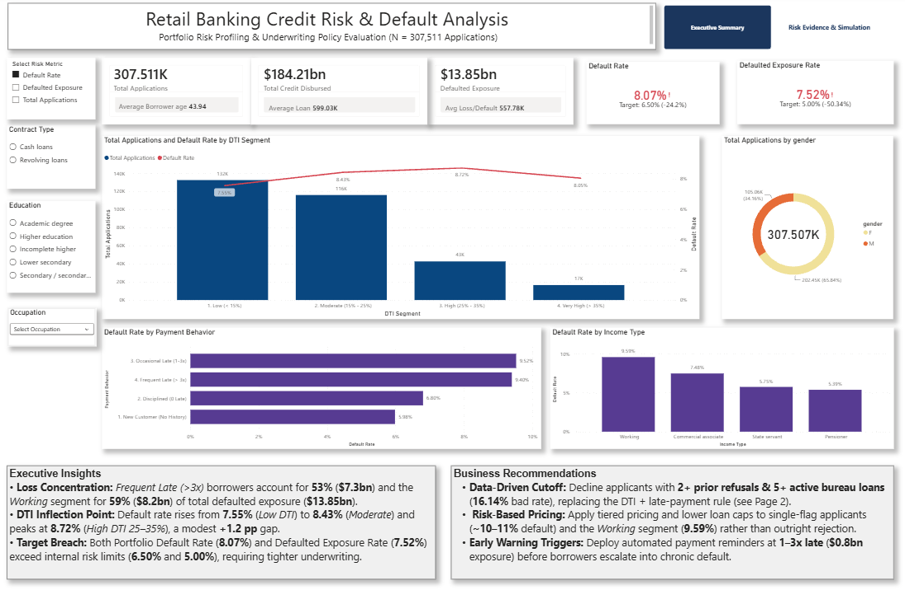
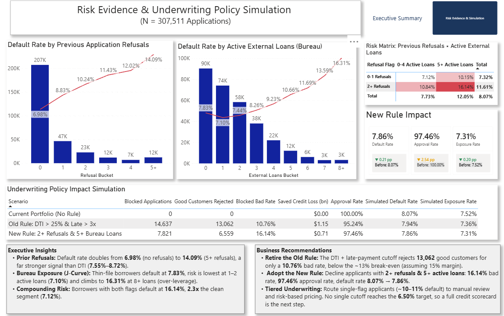
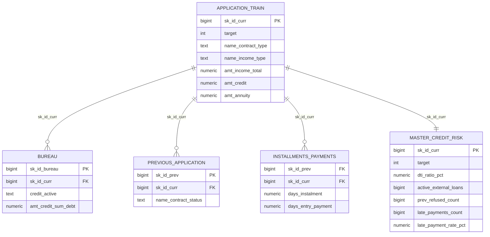

# Analisis Risiko Kredit & Gagal Bayar — Retail Banking

**Portfolio Risk Profiling & Underwriting Policy Evaluation | PostgreSQL + Power BI**

Proyek analisis risiko kredit end-to-end terhadap **307.511 pengajuan pinjaman ritel** (dataset Home Credit Default Risk). Proyek ini tidak berhenti di laporan deskriptif: saya mencari di mana gagal bayar terkonsentrasi, memvalidasi **tanda bahaya yang sudah terlihat sebelum pinjaman dicairkan**, lalu mensimulasikan **trade-off risiko vs keuntungan** dari beberapa aturan underwriting.




---

## 1. Masalah Bisnis

Kondisi portofolio saat ini melewati batas risiko internal bank:

| Metrik | Aktual | Batas Internal | Selisih |
|---|---|---|---|
| Default Rate | **8,07%** (24.825 gagal bayar) | 6,50% | +1,57 pp |
| Defaulted Exposure Rate | **7,52%** ($13,85bn dari $184,21bn) | 5,00% | +2,52 pp |

**Pertanyaan yang ingin dijawab:**
1. Di segmen mana risiko gagal bayar paling terkonsentrasi?
2. Informasi apa yang sudah tersedia **sebelum** pinjaman dicairkan dan bisa memprediksi gagal bayar?
3. Aturan underwriting seperti apa yang bisa menekan gagal bayar **tanpa menolak terlalu banyak nasabah baik**?

---

## 2. Data & Arsitektur

**Sumber data:** [Home Credit Default Risk (Kaggle)](https://www.kaggle.com/c/home-credit-default-risk). Data mentah tidak disertakan di repository ini karena ukurannya besar dan mengikuti aturan Kaggle.

| Tabel | Isi | Peran |
|---|---|---|
| `application_train` | Profil peminjam, penghasilan, jumlah pinjaman, status gagal bayar (`TARGET`) | Tabel utama |
| `bureau` | Pinjaman di lembaga lain (credit bureau / SLIK) | Beban utang eksternal |
| `previous_application` | Riwayat pengajuan sebelumnya (disetujui / ditolak) | Riwayat internal |
| `installments_payments` | Riwayat pembayaran cicilan | Kedisiplinan bayar |

### Entity Relationship Diagram (ERD)



Satu peminjam (`sk_id_curr`) bisa memiliki **banyak** catatan bureau, pengajuan sebelumnya, dan cicilan (hubungan *one-to-many*). Karena itu, ketiga tabel tersebut diringkas dulu menjadi 1 baris per peminjam sebelum digabung, sehingga hasil akhirnya tetap **1 baris = 1 peminjam**.

**Model di Power BI:** satu tabel utama (`master_credit_risk`) ditambah dua tabel bantu yang tidak terhubung: `Policy Scenario` (penggerak simulasi kebijakan) dan `Select Risk Metric` (field parameter).

### Alur Data

```
CSV Kaggle → PostgreSQL (4 tabel) → agregasi SQL (CTE + LEFT JOIN)
→ master_credit_risk (307.511 baris, 23 kolom) → Power BI (Import mode, DAX)
```

Script SQL (`sql/master_credit_risk.sql`) juga membuat fitur risiko baru seperti **Debt-to-Income (DTI %)**, credit-to-income ratio, jumlah pinjaman aktif di lembaga lain, jumlah penolakan sebelumnya, dan persentase keterlambatan bayar.

---

## 3. Isi Dashboard

### Page 1 — Executive Summary
*"Seberapa parah masalahnya, dan di mana konsentrasinya?"*

- Kartu KPI dibandingkan dengan target internal (Default Rate, Defaulted Exposure Rate)
- Default rate berdasarkan **segmen DTI**, **perilaku bayar**, dan **jenis penghasilan**
- Pengganti metrik dinamis (Default Rate / Defaulted Exposure / Applications) menggunakan **Field Parameter**

### Page 2 — Risk Evidence & Underwriting Policy Simulation
*"Tanda bahaya apa yang bisa dipercaya, dan aturan mana yang terbaik?"*

- Default rate berdasarkan **jumlah penolakan sebelumnya** dan **jumlah pinjaman aktif di lembaga lain**
- **Risk matrix** (heatmap) kombinasi kedua tanda bahaya
- **Simulator kebijakan**: Current Portfolio vs Old Rule vs New Rule
- Kartu **"New Rule Impact"** dengan perbandingan sebelum/sesudah dan warna kondisional

---

## 4. Temuan Utama

**1. DTI ternyata pembeda risiko yang lemah.**
Default rate hanya bergerak dari **7,55%** (DTI < 15%) ke puncak **8,72%** (DTI 25–35%), lalu turun lagi ke **8,05%** di atas 35%. Kemungkinan besar karena pengajuan dengan DTI tinggi sudah disaring lebih ketat saat persetujuan awal (*selection bias*).

**2. Segmentasi berdasarkan jumlah keterlambatan bisa menyesatkan.**
Kelompok *Occasional Late (1–3x)* gagal bayar **9,52%**, sedikit **lebih tinggi** dari *Frequent Late (>3x)* yang **9,40%**. Jumlah keterlambatan cenderung bertambah seiring panjangnya riwayat cicilan, sehingga nasabah lama ikut terkena "hukuman".

**3. Riwayat penolakan adalah sinyal yang kuat dan konsisten.**

| Penolakan sebelumnya | 0 | 1 | 2 | 3 | 4 | 5+ |
|---|---|---|---|---|---|---|
| Default rate | 6,98% | 8,83% | 10,24% | 11,43% | 12,02% | **14,09%** |

Risiko gagal bayar **naik dua kali lipat** dari kelompok tanpa penolakan ke kelompok 5+ penolakan.

**4. Pinjaman di lembaga lain membentuk pola J.**

| Pinjaman aktif eksternal | 0 | 1 | 2 | 3 | 4 | 5 | 6 | 7 | 8+ |
|---|---|---|---|---|---|---|---|---|---|
| Default rate | 7,83% | **7,10%** | 7,44% | 8,26% | 9,23% | 10,66% | 11,69% | 13,59% | **16,31%** |

Peminjam tanpa riwayat kredit aktif (*thin file*) justru lebih berisiko dibanding yang sedang mengelola 1–2 pinjaman. Setelah itu, risiko terus naik seiring bertambahnya utang (*over-leverage*).

**5. Risiko bertumpuk kalau kedua tanda bahaya muncul bersamaan.**

| | 0–4 pinjaman aktif | 5+ pinjaman aktif |
|---|---|---|
| **0–1 penolakan** | 7,12% | 10,15% |
| **2+ penolakan** | 10,84% | **16,14%** |

---

## 5. Simulasi Kebijakan Underwriting

| Skenario | Ditolak | Nasabah Baik Ikut Ditolak | Bad Rate yang Ditolak | Exposure Diselamatkan | Approval Rate | Default Rate Setelahnya | Exposure Rate Setelahnya |
|---|---|---|---|---|---|---|---|
| Current Portfolio | 0 | 0 | – | $0,00bn | 100,00% | 8,07% | 7,52% |
| **Old Rule:** DTI > 25% & telat > 3x | 14.637 | 13.062 | 10,76% | $1,15bn | 95,24% | 7,94% | 7,36% |
| **New Rule:** 2+ penolakan & 5+ pinjaman bureau | **7.821** | **6.559** | **16,14%** | $0,71bn | **97,46%** | **7,86%** | **7,31%** |

**Cara membacanya:**
- **New Rule** menghasilkan default rate yang **lebih rendah** sambil menolak **sekitar setengah** jumlah nasabah baik dibanding Old Rule.
- Old Rule memang menyelamatkan exposure $0,43bn lebih banyak, tetapi harganya **6.503 nasabah baik tambahan** ikut ditolak.
- Bad rate Old Rule (10,76%) berada **di bawah** perkiraan titik impas sekitar 13% (dengan asumsi margin 15% dan LGD 100%). Artinya, menolak segmen ini kemungkinan justru mengurangi keuntungan bank.

> Hipotesis awal saya (aturan berbasis DTI + keterlambatan bayar di Page 1) **diuji dan terbukti kurang efektif**. Sinyal dari riwayat bureau dan riwayat pengajuan jauh lebih kuat.

---

## 6. Rekomendasi

1. **Terapkan New Rule:** tolak pengajuan dengan **2+ penolakan sebelumnya DAN 5+ pinjaman aktif di bureau** (bad rate 16,14%, approval rate 97,46%).
2. **Underwriting bertingkat:** pengajuan dengan satu tanda bahaya saja (default ~10–11%) diarahkan ke **review manual dan risk-based pricing**, bukan langsung ditolak.
3. **Early warning:** kirim pengingat pembayaran otomatis untuk nasabah yang terlambat 1–3 kali (exposure $0,8bn) sebelum menjadi gagal bayar.
4. **Langkah berikutnya:** tidak ada satu aturan tunggal yang bisa mencapai target 6,50%. Dibutuhkan **credit scorecard** yang lebih lengkap (misalnya logistic regression dengan skor kredit eksternal).

---

## 7. Asumsi & Keterbatasan

- **Defaulted Exposure** memakai jumlah pinjaman awal secara penuh (**LGD = 100%**, tanpa recovery atau pengurangan pokok). Expected loss yang sebenarnya (PD × EAD × LGD) akan lebih kecil.
- Dataset hanya berisi **pinjaman yang disetujui**. Pengajuan yang ditolak tidak punya data hasil, sehingga ada potensi *selection bias* (*reject inference* tidak dibahas).
- **Margin 15%** pada analisis titik impas adalah **asumsi**, bukan data.
- Dataset tidak menyebutkan mata uang. Simbol `$` dipakai agar mudah dibaca.
- Hasil analisis menunjukkan **korelasi historis**, bukan hubungan sebab-akibat.

---

## 8. Tools

| Tool | Kegunaan |
|---|---|
| **PostgreSQL** (pgAdmin 4) | Data engineering: CTE, agregasi, LEFT JOIN, feature engineering |
| **Power BI Desktop** | Data modelling, DAX measures, field parameter, tabel skenario, conditional formatting, page navigation |
| **DAX** | `CALCULATE`, `SWITCH`, `SELECTEDVALUE`, `DIVIDE`, `DATATABLE`, reference label dinamis |

Daftar lengkap DAX ada di [`dax/measures.dax`](dax/measures.dax).

### Contoh DAX — simulator kebijakan berbasis skenario

Tabel `Policy Scenario` yang tidak terhubung ke tabel utama menjadi penggerak semua measure simulasi:

```dax
Blocked Applications =
VAR s = SELECTEDVALUE('Policy Scenario'[Order], 1)
RETURN
SWITCH(s,
    2, CALCULATE([Total Applications], 'public master_credit_risk'[Old Rule Blocked] = 1),
    3, CALCULATE([Total Applications], 'public master_credit_risk'[New Rule Blocked] = 1),
    0
)

Simulated Default Rate =
DIVIDE(
    SUM('public master_credit_risk'[target]) - [Blocked Defaults],
    [Total Applications] - [Blocked Applications]
)
```

---

## 9. Struktur Repository

```
credit-risk-default-analysis/
├── README.md
├── sql/
│   └── master_credit_risk.sql          # Script SQL (pembuatan tabel + query analisis)
├── dax/
│   └── measures.dax                    # Semua calculated column, tabel, dan measure
├── images/
│   ├── page1_executive_summary.png
│   └── page2_risk_evidence_simulation.png
├── docs/
│   └── Credit_Risk_Dashboard.pdf       # Export PDF dashboard
└── powerbi/
    └── Credit_Risk_Dashboard.pbix      # File Power BI
```

## 10. Cara Menjalankan Ulang

1. Unduh dataset dari Kaggle, lalu import 4 tabel ke PostgreSQL.
2. Jalankan `sql/master_credit_risk.sql` untuk membuat tabel `master_credit_risk`.
3. Buka `powerbi/Credit_Risk_Dashboard.pbix` di Power BI Desktop, lalu sesuaikan koneksi PostgreSQL.

---

**Dibuat oleh:** Visal Ady Yanuar · https://www.linkedin.com/in/visal-ady-yanuar-a5bb882b5/
